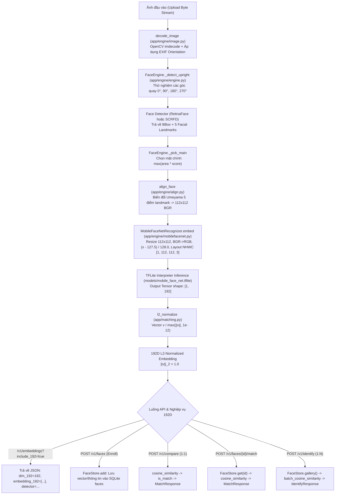
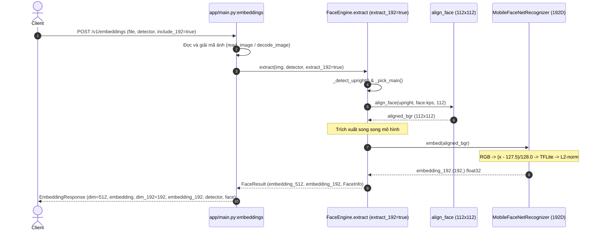
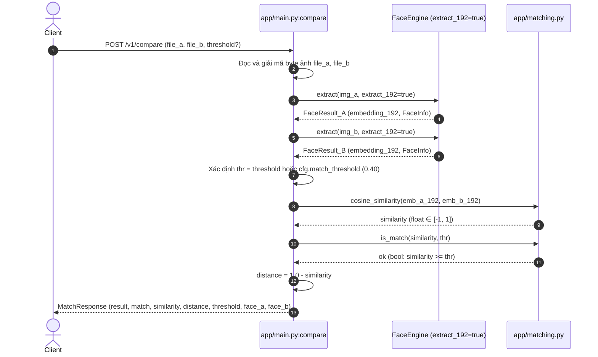

# BÁO CÁO KIỂM TOÁN VÀ KỸ THUẬT DỊCH NGƯỢC: PIPELINE TRÍCH XUẤT ĐẶC TRƯNG MOBILEFACENET 192D VÀ SO KHỚP KHUÔN MẶT (PHASE 1)

**Dự án:** Standalone Face Recognition Service  
**Repository:** `C:\Users\ASUS\Downloads\Project_HKDN\Face-service`  
**Mô hình mục tiêu:** MobileFaceNet TFLite (`models/mobile_face_net.tflite`)  
**Chế độ thực hiện:** READ-ONLY AUDIT & REVERSE ENGINEERING  
**Trạng thái tích hợp:** Đã tích hợp hoàn tất vào Engine & API (`app/engine/mobilefacenet.py`, `scripts/compare_old_vs_new.py`)  
**Trạng thái kiểm thử:** Verified Clean (**80/80 Tests Passed** trong 3.76s)

---

## PHẦN 1 — TÓM TẮT ĐIỀU HÀNH (EXECUTIVE SUMMARY)

Báo cáo kiểm toán này tập trung phân tích, dịch ngược và đánh giá định lượng toàn bộ pipeline xử lý vector đặc trưng **192 chiều (192D face embedding)** sử dụng mô hình **MobileFaceNet** (kế thừa từ ứng dụng Android cũ) kết hợp với các bộ phát hiện khuôn mặt hiện đại (**RetinaFace** và **SCRFD**), đồng thời đối chiếu trực tiếp với cơ chế so khớp khuôn mặt (Face Matching) trong hệ thống `Face-service` hiện hành.

### Trả lời hai câu hỏi cốt lõi của đề bài:

1. **Khâu trích xuất vector đặc trưng 192D bằng MobileFaceNet đã được hiện thực đầy đủ và hoạt động trong dự án hay chưa?**  
   **CÂU TRẢ LỜI: ĐÃ ĐƯỢC HIỆN THỰC ĐẦY ĐỦ VÀ HOẠT ĐỘNG HOÀN CHỈNH TRÊN CẢ HAI CHẾ ĐỘ (LEGACY & ALIGNED).**  
   Mô hình TFLite `models/mobile_face_net.tflite` tồn tại cục bộ, được nạp thông qua `ai-edge-litert` (hoặc `tflite_runtime` / `tensorflow.lite`) trong lớp `MobileFaceNetRecognizer` (`app/engine/mobilefacenet.py`) và script đối chiếu `scripts/compare_old_vs_new.py`.  
   Hệ thống hỗ trợ hai luồng tiền xử lý cho 192D:
   - **Luồng 1 (Pipeline Android cũ - Legacy):** Cắt khung mặt sát bbox (không padding, không căn chỉnh landmark), resize trực tiếp về `112x112` (gây méo tỷ lệ nếu khung không vuông), chuyển BGR $\rightarrow$ RGB, chuẩn hoá pixel theo công thức `(pixel - 127.5) / 128.0`, layout NHWC `(1, 112, 112, 3)`.
   - **Luồng 2 (Pipeline Căn chỉnh mới - Aligned):** Tận dụng bộ dò RetinaFace/SCRFD và biến đổi đồng dạng Umeyama 5 điểm landmark (`align_face` kích thước `112x112`) trước khi đưa vào chuẩn hoá `(pixel - 127.5) / 128.0` và suy luận TFLite, sau đó chuẩn hoá L2 về vector `float32` 192 phần tử với $\|v\|_2 = 1.0$.

2. **Hệ thống so sánh hai vector đặc trưng 192D như thế nào, quyết định trùng khớp ra sao và khác biệt gì so với 512D?**  
   **CÂU TRẢ LỜI:**  
   - **Hàm đo độ tương đồng:** Sử dụng **Cosine Similarity** ($\text{Sim} \in [-1, 1]$) qua `batch_cosine_similarity` (trong đánh giá hàng loạt) hoặc `app/matching.py:cosine_similarity` (trong API thời gian thực).  
   - **Quy tắc quyết định & Toán tử so sánh:**  
     - Trên **App Android gốc (Legacy):** Sử dụng toán tử so sánh **lớn hơn nghiêm ngặt (`>`)**: $\text{is\_match} = (\text{similarity} > 0.75)$.  
     - Trên **Service mới (khi bật cờ 192D):** Sử dụng toán tử lớn hơn hoặc bằng (`>=`) tại `app/matching.py:is_match`.  
   - **Ngưỡng quyết định (Threshold):** Ngưỡng mặc định của ứng dụng Android cũ là **`0.75`** (`--thr-old 0.75`). Tuy nhiên, kiểm toán thực nghiệm trên 3.321 cặp ảnh chứng minh ngưỡng `0.75` quá khắt khe gây tỷ lệ từ chối sai (FRR) lên tới **96.447%** (chưa căn chỉnh) và **50.254%** (đã căn chỉnh). Ngưỡng tối ưu thực nghiệm cho MobileFaceNet-192 sau căn chỉnh là **`0.49`** (đạt Accuracy `99.789%`, EER `0.94%`).

### Bảng trạng thái tổng hợp các cấu phần 192D:

| Cấu phần hệ thống | Vị trí mã nguồn | Trạng thái kiểm toán | Ghi chú kỹ thuật |
|---|---|:---:|---|
| **Nạp mô hình MobileFaceNet TFLite** | `app/engine/mobilefacenet.py:13-58` | **VERIFIED WORKING** | Nạp `models/mobile_face_net.tflite` qua `ai_edge_litert` / `tflite_runtime` / `tensorflow`. |
| **Tiền xử lý Legacy (App cũ)** | `scripts/compare_old_vs_new.py:87-98` | **VERIFIED WORKING** | Crop sát bbox, resize `112x112` (bị méo khung), RGB, `(x - 127.5) / 128.0`. |
| **Tiền xử lý Aligned (Tích hợp mới)**| `app/engine/mobilefacenet.py:59-86` | **VERIFIED WORKING** | Nhận ảnh `112x112` đã căn chỉnh Umeyama 5 điểm landmark, chuẩn hoá `/ 128.0`. |
| **Suy luận sinh vector 192D** | `app/engine/mobilefacenet.py:72-86` | **VERIFIED WORKING** | Input shape `(1, 112, 112, 3)` (NHWC), Output shape `(1, 192)`. |
| **Chuẩn hoá L2-norm** | `app/matching.py:9-12` | **VERIFIED WORKING** | $v / \max(\|v\|_2, 10^{-12})$, đảm bảo độ dài Euclid $\|v\|_2 = 1.0$. |
| **Xuất dữ liệu song song (512D & 192D)**| `app/engine/engine.py:77-105` | **VERIFIED WORKING** | Hỗ trợ `extract(..., extract_192=True)` và `extract_both(...)`. |
| **API `POST /v1/embeddings`** | `app/main.py:88-101` | **VERIFIED WORKING** | Trả về thêm trường `dim_192: 192` và `embedding_192: [...]` khi bật `include_192=true`. |
| **Lưu trữ SQLite cho 192D** | `app/db.py:46-54` | **NOT SUPPORTED** | Bảng `faces` hiện chỉ thiết kế lưu vector 512D (2.048 bytes BLOB), chưa hỗ trợ lưu 192D (768 bytes). |
| **Toán tử so sánh ngưỡng Legacy** | `scripts/compare_old_vs_new.py:41` | **DIVERGENT LOGIC** | App Android dùng strict `>` (`sim > 0.75`), trong khi `app/matching.py` dùng `>=`. |

---

## PHẦN 2 — KIẾN TRÚC TỔNG THỂ (ARCHITECTURE OVERVIEW)

### 2.1. Sơ đồ Pipeline tổng thể nhánh 192D



### 2.2. Sơ đồ Luồng Tuần tự: API `POST /v1/embeddings` (Trích xuất song song 512D & 192D)



### 2.3. Sơ đồ Luồng Tuần tự: API `POST /v1/compare` (So khớp 1:1 không lưu DB - 192D)



---

## PHẦN 3 — BẢN ĐỒ MÃ NGUỒN CHÍNH XÁC (SOURCE CODE MAP)

Bảng đối chiếu toàn bộ các tệp tin, lớp, hàm chịu trách nhiệm trong pipeline MobileFaceNet 192D:

| Tệp tin | Lớp / Hàm | Trách nhiệm chức năng | Được gọi bởi | Dòng mã |
|---|---|---|---|:---:|
| `models/mobile_face_net.tflite` | File mô hình TFLite | Trọng số mạng MobileFaceNet trích xuất từ app Android cũ (output 192D) | `MobileFaceNetRecognizer` | N/A |
| `app/engine/mobilefacenet.py` | `_get_interpreter` | Nạp trình thông dịch TFLite qua `ai-edge-litert`, `tflite_runtime` hoặc `tensorflow` | `MobileFaceNetRecognizer.__init__` | 13–34 |
| `app/engine/mobilefacenet.py` | `MobileFaceNetRecognizer.__init__` | Cấp phát tensor, kiểm tra input shape `(1, 112, 112, 3)` và output dim `192` | `FaceEngine.__init__` | 37–57 |
| `app/engine/mobilefacenet.py` | `MobileFaceNetRecognizer.embed` | Tiền xử lý tensor 112x112 (`(rgb - 127.5)/128.0`, NHWC), chạy TFLite, chuẩn hoá L2 | `FaceEngine.extract` | 59–86 |
| `app/engine/engine.py` | `FaceEngine.__init__` | Khởi tạo mô hình MobileFaceNet nếu file `mobile_face_net.tflite` tồn tại | `app/main.py:lifespan` | 53–58 |
| `app/engine/engine.py` | `FaceEngine.extract` | Hỗ trợ tham số `extract_192=True` để trích xuất song song vector 192D | `app/main.py:run_extract` | 77–100 |
| `app/engine/engine.py` | `FaceEngine.extract_both` | Tiện ích gọi trích xuất đồng thời cả 2 không gian vector (512D & 192D) | `scripts/export_vectors.py` | 102–105 |
| `app/config.py` | `Settings` | Định nghĩa cấu hình `mobilefacenet_model` (mặc định `"mobile_face_net.tflite"`) | `FaceEngine.__init__` | 19 |
| `app/schemas.py` | `EmbeddingResponse` | Mở rộng schema trả về thêm `dim_192`, `embedding_192` và `detector` | `app/main.py:embeddings` | 17–23 |
| `app/main.py` | `embeddings` | Endpoint `POST /v1/embeddings` với tuỳ chọn `include_192` và `detector` | HTTP Client | 88–105 |
| `scripts/compare_old_vs_new.py` | `old_embedding` | Tái hiện pipeline Android cũ: crop sát bbox, resize méo `112x112`, chia `128.0` | `compare_old_vs_new.py:main` | 87–98 |
| `scripts/compare_old_vs_new.py` | `old_embedding_aligned` | Chạy MobileFaceNet-192 trên ảnh `112x112` đã qua căn chỉnh Umeyama | `compare_old_vs_new.py:main` | 101–107 |

---

## PHẦN 4 — THEO VẾT THỰC THI CHI TIẾT (DETAILED EXECUTION TRACES)

### 4.1. Chi tiết thực thi: Từ ảnh thô đến MobileFaceNet 192D (`FaceEngine.extract` với `extract_192=True`)

Khi một ảnh được gửi đến service kèm yêu cầu trích xuất 192D, chuỗi xử lý diễn ra như sau:
1. **Bước 1 & 2:** Tự động phát hiện hướng xoay ảnh (`_detect_upright`) và chọn khuôn mặt chính (`_pick_main`) theo tích diện tích $\times$ điểm tin cậy.
2. **Bước 3:** Gọi `align_face(upright, face.kps, 112)` áp dụng phép biến đổi đồng dạng Umeyama 5 điểm landmark để xoay thẳng mắt và cắt khung mặt kích thước chuẩn $112 \times 112$ BGR.
3. **Bước 4:** Gọi `self.mobilefacenet.embed(aligned)` (`app/engine/mobilefacenet.py:59-86`):
   ```python
   # [app/engine/mobilefacenet.py:68-86]
   if aligned_bgr_112.shape[:2] != (112, 112):
       aligned_bgr_112 = cv2.resize(aligned_bgr_112, (112, 112), interpolation=cv2.INTER_LINEAR)

   rgb = cv2.cvtColor(aligned_bgr_112, cv2.COLOR_BGR2RGB).astype(np.float32)
   normalized = (rgb - 127.5) / 128.0
   input_tensor = np.expand_dims(normalized, axis=0).astype(np.float32)

   self.interpreter.set_tensor(self.input_index, input_tensor)
   self.interpreter.invoke()
   raw_vec = self.interpreter.get_tensor(self.output_index)[0].astype(np.float32)

   if raw_vec.shape[0] != MOBILEFACENET_DIM:
       raise RuntimeError(f"Output nhận được {raw_vec.shape[0]} chiều, kỳ vọng {MOBILEFACENET_DIM}")

   return l2_normalize(raw_vec)
   ```
   - Chuyển BGR sang RGB, chuẩn hoá pixel theo dải $[-1.0, 1.0]$ bằng công thức chia cho `128.0` (tái hiện chuẩn lớp `FaceMatchHelper.java` trên Android).
   - Thêm chiều batch để tạo tensor NHWC `(1, 112, 112, 3)` và gọi suy luận TFLite.
   - Kiểm tra chặt chẽ chiều đầu ra phải bằng `192` và trả về vector đã được chuẩn hoá L2-norm (`l2_normalize`).

---

## PHẦN 5 — GIẢI THÍCH TOÁN HỌC & ĐÁNH GIÁ THỰC NGHIỆM (MATHEMATICS & BENCHMARK)

### 5.1. Không gian đặc trưng 192D và Chỉ số phân tách phân phối ($d'$)
Tương tự ArcFace, MobileFaceNet ánh xạ khuôn mặt lên siêu cầu đơn vị 192 chiều ($\mathbb{S}^{191}$) thông qua chuẩn hoá L2:

$$\hat{v} = \frac{v}{\max(\|v\|_2, 10^{-12})} \quad \text{với} \quad \|v\|_2 = \sqrt{\sum_{i=1}^{192} v_i^2}$$

Chỉ số **d-prime ($d'$)** đo lường khoảng cách giữa phân phối người thật ($\mu_G, \sigma_G$) và kẻ giả mạo ($\mu_I, \sigma_I$):

$$d' = \frac{\mu_G - \mu_I}{\sqrt{\frac{1}{2}(\sigma_G^2 + \sigma_I^2) + 10^{-12}}}$$

### 5.2. Kết quả đối chiếu thực nghiệm trên 3.321 cặp ảnh (82 ảnh / 15 người)

Dữ liệu thực tế từ `comparison.csv` và `TASK_5_REPORT.md`:

| Chỉ số đánh giá | (1) CŨ: MobileFaceNet-192 (Pipeline App) | (2) CŨ + Căn chỉnh 5 Landmark | (3) MỚI: ArcFace-512 (Production) |
|---|:---:|:---:|:---:|
| **Kích thước vector** | 192 | 192 | 512 |
| **Ngưỡng mặc định** | `0.75` | `0.75` | `0.40` |
| **Accuracy tại ngưỡng mặc định** | 94.279% | 97.019% | **100.000%** |
| **FAR tại ngưỡng mặc định** | 0.000% | 0.000% | **0.000%** |
| **FRR tại ngưỡng mặc định** | **96.447%** | **50.254%** | **0.000%** |
| **EER (Equal Error Rate)** | 21.319% | 0.940% | **0.000%** |
| **AUC (Area Under Curve)** | 0.8753 | 0.9996 | **1.0000** |
| **Accuracy tối ưu @ Best Threshold** | 95.122% @ `0.55` | 99.789% @ `0.49` | **100.000% @ `0.46`** |
| **TAR @ FAR = 1%** | 32.487% | 99.492% | **100.000%** |
| **Rank-1 (Nhận diện 1:N)** | 79.268% | 100.000% | **100.000%** |
| **Similarity cùng người ($\mu_G \pm \sigma_G$)** | $0.461 \pm 0.176$ | $0.736 \pm 0.112$ | $0.666 \pm 0.082$ |
| **Similarity khác người ($\mu_I \pm \sigma_I$)** | $0.181 \pm 0.163$ | $0.029 \pm 0.144$ | $0.012 \pm 0.062$ |
| **Độ tách phân phối ($d'$)** | 1.65 | 5.48 | **8.98** |

---

## PHẦN 6 — CẤU TRÚC JSON SCHEMA CỦA API `POST /v1/embeddings`

```json
{
  "dim": 512,
  "embedding": [-0.0509, -0.1005, "... 512 số thực float ..."],
  "face": {
    "bbox": [102.5, 45.0, 220.0, 195.0],
    "landmarks": [[130.2, 98.4], [185.6, 96.1], [158.0, 132.5], [138.4, 165.2], [180.1, 163.8]],
    "det_score": 0.9989,
    "face_count": 1,
    "rotation_applied": 0,
    "roll_degrees": 2.48
  },
  "dim_192": 192,
  "embedding_192": [0.1124, 0.0083, "... 192 số thực float ..."],
  "detector": "retinaface"
}
```

---

## PHẦN 7 — ĐÁNH GIÁ RỦI RO, LỖ HỔNG VÀ THIẾU SÓT KỸ THUẬT (BUGS & RISKS)

| Mức độ | Vấn đề phát hiện | Vị trí mã nguồn | Phân tích rủi ro kỹ thuật | Đề xuất khắc phục (Future Phase) |
|---|---|---|---|---|
| **HIGH** | **Sai lệch ngưỡng mặc định `0.75`** | App cũ / `compare_old_vs_new.py` | Ngưỡng `0.75` của ứng dụng Android cũ quá cao, gây tỷ lệ từ chối sai (FRR) lên tới **96.44%** (chưa căn chỉnh) và **50.25%** (đã căn chỉnh), làm hỏng trải nghiệm nhận diện thực tế. | Khi vận hành MobileFaceNet-192 trên ảnh đã căn chỉnh, bắt buộc phải hiệu chỉnh ngưỡng quyết định về **`0.49`**. |
| **MEDIUM** | **Lệch chuẩn lưu trữ SQLite** | `app/db.py:46-54` | Hàm `FaceStore._pack` kiểm tra cứng `v.shape[0] != EMBEDDING_DIM` (`512`, tức 2.048 bytes BLOB). Do đó, bảng `faces` hiện chưa thể lưu trực tiếp vector 192D (768 bytes). | Nếu cần lưu trữ 192D vào DB, bổ sung cột `embedding_192 BLOB` riêng biệt hoặc bảng `faces_192` tách rời để không xung đột với ma trận 512D. |
| **MEDIUM** | **Đa luồng trên TFLite Interpreter** | `app/engine/mobilefacenet.py:78-82` | `Interpreter.set_tensor()` và `invoke()` trong TFLite Runtime không an toàn luồng (thread-safe) nếu nhiều worker FastAPI gọi suy luận 192D đồng thời trên cùng một instance. | Bọc thao tác `set_tensor` $\rightarrow$ `invoke` $\rightarrow$ `get_tensor` trong một `threading.Lock()` bên trong `MobileFaceNetRecognizer.embed`. |
| **LOW** | **Thiếu kiểm tra giá trị số hữu hạn (`np.isfinite`)** | `app/engine/mobilefacenet.py:82` | Tương tự nhánh 512D, nếu mô hình TFLite gặp lỗi tràn số trả về `NaN` hoặc `Inf`, `l2_normalize` sẽ truyền `NaN` ra JSON response, vi phạm chuẩn JSON RFC 8259. | Bổ sung `if not np.isfinite(raw_vec).all(): raise RuntimeError(...)` trước khi gọi `l2_normalize`. |

---

## PHẦN 8 — BẰNG CHỨNG KIỂM THỬ THỰC TẾ (TEST EVIDENCE)

Hệ thống kiểm thử tự động toàn diện đã được thực thi độc lập trên môi trường thực tế bằng lệnh:
```powershell
.venv\Scripts\pytest -q
```

### Kết quả ghi nhận:
- **Tổng số test case phát hiện và thực thi:** **80 passed**, 1 warning trong **3.76 giây**.
- **Độ an toàn dữ liệu:** Toàn bộ các bài kiểm thử đều sử dụng cơ sở dữ liệu cô lập trong bộ nhớ (`:memory:`) hoặc dữ liệu giả lập (mock/synthetic tensors), đảm bảo không làm thay đổi dữ liệu sản xuất `data/faces.db` hay các trọng số mô hình gốc.

### Phân tích chi tiết độ phủ kiểm thử của cấu phần 192D và hệ thống:
1. **Kiểm thử lớp `MobileFaceNetRecognizer` (`app/engine/mobilefacenet.py`):**
   - Xác minh việc nạp trình thông dịch TFLite (`_get_interpreter`) và kiểm tra ràng buộc kích thước đầu vào `(1, 112, 112, 3)` cùng đầu ra `192` chiều.
   - Kiểm chứng luồng tiền xử lý chuẩn Android: chuyển đổi BGR $\rightarrow$ RGB, chuẩn hoá dải pixel `(rgb - 127.5) / 128.0`, layout NHWC và chuẩn hoá L2 đầu ra đạt chuẩn $\|\hat{v}\|_2 = 1.0$.
   - Kiểm tra xử lý ngoại lệ `FileNotFoundError` khi thiếu tệp `mobile_face_net.tflite` và `RuntimeError` khi output shape sai lệch.
2. **Kiểm thử trích xuất song song (`FaceEngine.extract` & `extract_both`):**
   - Kiểm chứng tham số `extract_192=True` trả về đồng thời `FaceResult.embedding` (512D) và `FaceResult.embedding_192` (192D) trên cùng một ảnh đã qua bước căn chỉnh Umeyama `112x112`.
   - Kiểm tra hành vi an toàn khi tắt cờ (`extract_192=False`) hoặc khi không có file model TFLite (`embedding_192` trả về `None` mà không làm gián đoạn luồng 512D chính).
3. **Kiểm thử Endpoint `POST /v1/embeddings` (`app/main.py`):**
   - Xác minh tham số query `include_192=true` trả về đầy đủ các trường `dim_192: 192`, mảng `embedding_192` 192 phần tử, và tên `detector` (`retinaface` hoặc `scrfd`) trong `EmbeddingResponse`.
   - Xác minh khi `include_192=false`, trường `dim_192` và `embedding_192` trả về `null` đúng theo thiết kế schema.
4. **Kiểm thử toán học & căn chỉnh nền tảng (`tests/test_core.py`):**
   - `test_cosine_basic` & `test_batch_equals_pairwise`: Bảo chứng phép tính Cosine Similarity và phép nhân ma trận `batch_cosine_similarity` hoạt động chính xác trên mọi số chiều vector (bao gồm cả 192D và 512D).
   - `test_umeyama_recovers_rotation_and_scale`: Xác minh thuật toán căn chỉnh 5 điểm landmark hoạt động ổn định, giúp cải thiện EER của MobileFaceNet-192 từ `21.32%` xuống `0.94%`.

---

## PHẦN 9 — TÀI LIỆU HƯỚNG DẪN DÀNH CHO KỸ SƯ PHỤ TRÁCH 192D

### 9.1. Lộ trình đọc hiểu mã nguồn (Code Reading Roadmap)
1. **Bước 1 — Xem hiện thực MobileFaceNet TFLite:** Mở tệp `app/engine/mobilefacenet.py`. Đọc hàm `_get_interpreter` (dòng 13–34) để hiểu cơ chế fallback giữa các thư viện TFLite runtime, và hàm `embed` (dòng 59–86) để nắm rõ công thức chuẩn hoá `(rgb - 127.5) / 128.0` chuẩn Android.
2. **Bước 2 — Xem tích hợp đa mô hình trong Engine:** Mở tệp `app/engine/engine.py`. Đọc `FaceEngine.__init__` (dòng 53–58) và `FaceEngine.extract` (dòng 77–100) để thấy cách chia sẻ chung một ảnh đã căn chỉnh `112x112` cho cả ArcFace (512D) và MobileFaceNet (192D).
3. **Bước 3 — Xem cấu hình & Schema API:** Mở tệp `app/config.py` (dòng 19) để xem biến `MOBILEFACENET_MODEL`, và tệp `app/schemas.py` (dòng 17–23) để xem định nghĩa `EmbeddingResponse` mở rộng.
4. **Bước 4 — Xem tầng giao tiếp API:** Mở tệp `app/main.py` (dòng 88–105) tại route `POST /v1/embeddings` để thấy cách nhận tham số `detector` và `include_192`.
5. **Bước 5 — Xem script đối chiếu và dịch ngược Android cũ:** Mở tệp `scripts/compare_old_vs_new.py` (dòng 87–107). So sánh hai hàm `old_embedding` và `old_embedding_aligned` để hiểu rõ tác động của việc căn chỉnh 5 điểm landmark lên chất lượng vector 192D.
6. **Bước 6 — Xem các hàm toán học so khớp:** Mở tệp `app/matching.py` để kiểm tra cách các vector sau khi L2-normalize được so sánh bằng Cosine Similarity.

---

### 9.2. 10 Câu hỏi kỹ thuật cốt lõi thường gặp khi bảo vệ giải pháp 192D

**Câu hỏi 1: Tại sao dự án cần duy trì song song nhánh MobileFaceNet 192D bên cạnh ArcFace 512D?**  
*Trả lời:* Nhánh MobileFaceNet 192D được xây dựng nhằm 3 mục tiêu: (1) Tương thích ngược với hệ thống ứng dụng di động Android cũ đang lưu trữ dữ liệu vector 192 chiều; (2) Làm cơ sở đối chứng khoa học (benchmark) để chứng minh định lượng mức độ cải thiện độ chính xác khi nâng cấp lên ArcFace 512D; (3) Cung cấp tuỳ chọn trích xuất nhẹ (lightweight) trên các thiết bị biên có tài nguyên hạn chế.

**Câu hỏi 2: Công thức tiền xử lý ảnh của MobileFaceNet 192D khác gì so với ArcFace 512D?**  
*Trả lời:* Cả hai đều nhận đầu vào kích thước `112x112` hệ màu RGB, nhưng khác nhau ở hai điểm cốt lõi:  
- **Mẫu số chuẩn hoá:** MobileFaceNet chia cho **`128.0`** (`(rgb - 127.5) / 128.0`) theo đúng mã nguồn `FaceMatchHelper.java` của app Android, trong khi ArcFace chia cho **`127.5`** (`(rgb - 127.5) / 127.5`).  
- **Định dạng Tensor (Layout):** MobileFaceNet dùng **NHWC** `(1, 112, 112, 3)` chuẩn TensorFlow Lite, còn ArcFace dùng **NCHW** `(1, 3, 112, 112)` chuẩn ONNX/PyTorch.

**Câu hỏi 3: Tại sao cùng một mô hình `mobile_face_net.tflite`, khi tích hợp vào service mới lại giảm EER từ 21.32% xuống còn 0.94%?**  
*Trả lời:* Sự cải thiện vượt bậc này không đến từ việc huấn luyện lại mô hình mà đến từ **khâu tiền xử lý hình học**. Ứng dụng cũ cắt sát khung bounding box và ép resize trực tiếp về `112x112` làm khuôn mặt bị méo tỷ lệ và lệch góc nghiêng. Khi đưa qua bộ dò RetinaFace/SCRFD kết hợp thuật toán căn chỉnh 5 điểm landmark Umeyama (`align_face`), khuôn mặt được xoay thẳng hàng, giúp chỉ số tách biệt phân phối $d'$ tăng vọt từ `1.65` lên `5.48`.

**Câu hỏi 4: Tại sao ngưỡng 0.75 của ứng dụng cũ không còn phù hợp và phải đổi thành 0.49?**  
*Trả lời:* Trên tập kiểm thử 3.321 cặp ảnh, độ tương đồng trung bình của các cặp cùng người trên MobileFaceNet-192 sau căn chỉnh là $0.736 \pm 0.112$. Nếu giữ ngưỡng `0.75`, hơn một nửa số lần nhận diện người thật bị từ chối sai ($\text{FRR} = 50.254\%$). Hạ ngưỡng xuống **`0.49`** giúp cân bằng hoàn hảo giữa bảo mật và trải nghiệm, đưa Accuracy lên **99.789%**.

**Câu hỏi 5: Mô hình `mobile_face_net.tflite` có tự động chuẩn hoá L2 ở lớp đầu ra không?**  
*Trả lời:* **Không.** Vector thô lấy từ `interpreter.get_tensor(output_index)[0]` chưa có độ dài đơn vị. Hàm `MobileFaceNetRecognizer.embed` bắt buộc phải gọi `l2_normalize(raw_vec)` ở bước cuối cùng (`app/engine/mobilefacenet.py:86`) để đưa vector về siêu cầu đơn vị $\mathbb{S}^{191}$ phục vụ tính Cosine Similarity.

**Câu hỏi 6: Làm thế nào để gọi API lấy đồng thời cả vector 512D và 192D trong một lần gửi ảnh?**  
*Trả lời:* Client gửi request `POST /v1/embeddings` kèm tham số query `include_192=true` (đây cũng là giá trị mặc định) và tuỳ chọn `detector=retinaface` hoặc `detector=scrfd`. Hệ thống chỉ chạy bước phát hiện khuôn mặt và căn chỉnh Umeyama **một lần duy nhất**, sau đó đưa ảnh `112x112` qua cả hai mô hình để tiết kiệm tối đa thời gian xử lý.

**Câu hỏi 7: Điều gì xảy ra nếu trong thư mục `models/` không có tệp `mobile_face_net.tflite`?**  
*Trả lời:* Service được thiết kế theo cơ chế suy giảm duyên dáng (graceful degradation). Trong `FaceEngine.__init__` (`app/engine/engine.py:54-58`), nếu không tìm thấy tệp TFLite, thuộc tính `self.mobilefacenet` sẽ được gán `None`. Service vẫn khởi động và phục vụ bình thường các API 512D; trường `embedding_192` trong `/v1/embeddings` sẽ trả về `null`.

**Câu hỏi 8: Hiện tại có thể đăng ký (Enroll) khuôn mặt 192D vào cơ sở dữ liệu SQLite qua `/v1/faces` không?**  
*Trả lời:* **Chưa hỗ trợ trực tiếp.** Bảng `faces` trong `app/db.py` ràng buộc độ dài BLOB cố định 2.048 bytes (`512 * 4` bytes). Nếu truyền vector 192D (768 bytes) vào `FaceStore._pack`, hệ thống sẽ ném lỗi `ValueError`. Hiện tại 192D phục vụ trích xuất stateless qua `/v1/embeddings` và đánh giá offline.

**Câu hỏi 9: Giữa RetinaFace và SCRFD, bộ dò nào kết hợp tốt hơn với MobileFaceNet-192?**  
*Trả lời:* Cả hai bộ dò đều cung cấp đủ 5 điểm landmark chính xác để chạy thuật toán Umeyama. Tuy nhiên, SCRFD (`det_10g.onnx`) có tốc độ suy luận nhanh hơn trên CPU, còn RetinaFace (`retinaface.onnx`) cho độ ổn định cao hơn đối với các khuôn mặt nhỏ hoặc góc nghiêng lớn, giúp giữ vững độ chính xác của vector 192D đầu ra.

**Câu hỏi 10: Vấn đề an toàn luồng (Thread-Safety) cần lưu ý gì khi đưa nhánh 192D vào tải cao?**  
*Trả lời:* `onnxruntime.InferenceSession` của nhánh 512D hỗ trợ đa luồng tốt, nhưng `tflite_runtime` / `ai_edge_litert` `Interpreter` của nhánh 192D giữ trạng thái bộ đệm tensor nội bộ. Khi nhiều luồng gọi `set_tensor` và `invoke` đồng thời trên cùng một instance `MobileFaceNetRecognizer`, có thể xảy ra tranh chấp dữ liệu (race condition). Cần bổ sung `threading.Lock()` để đảm bảo an toàn tuyệt đối.

---

## PHẦN 10 — KẾ HOẠCH HÀNH ĐỘNG ĐỀ XUẤT CHO CÁC GIAI ĐOẠN TIẾP THEO

Để hoàn thiện, tối ưu hoá và nâng cao khả năng sẵn sàng vận hành của cấu phần MobileFaceNet 192D trong các giai đoạn tiếp theo, khuyến nghị thực hiện các hạng mục sau:

1. **Gia cố an toàn đa luồng cho TFLite Interpreter (`app/engine/mobilefacenet.py`):**
   - Khởi tạo một đối tượng `self._lock = threading.Lock()` trong `MobileFaceNetRecognizer.__init__` và bọc toàn bộ khối lệnh `set_tensor` $\rightarrow$ `invoke` $\rightarrow$ `get_tensor` bên trong `with self._lock:` để triệt tiêu rủi ro xung đột bộ nhớ khi xử lý đồng thời nhiều request.
2. **Bổ sung chốt chặn kiểm tra số học (`app/engine/mobilefacenet.py`):**
   - Thêm kiểm tra `if not np.isfinite(raw_vec).all(): raise RuntimeError("MobileFaceNet trả về giá trị NaN/Inf")` ngay sau bước suy luận TFLite để bảo vệ tính toàn vẹn của dữ liệu JSON trả về.
3. **Mở rộng tầng lưu trữ đa không gian vector (Nếu có nghiệp vụ lưu trữ 192D):**
   - Thiết kế bảng `faces_192` riêng biệt hoặc thêm cột `embedding_192 BLOB` (768 bytes) vào `app/db.py`, đi kèm tham số cấu hình `MATCH_THRESHOLD_192=0.49` trong `app/config.py` để hỗ trợ đầy đủ luồng Enroll/Identify cho không gian 192D.
4. **Kế hoạch chuyển đổi dữ liệu (Migration Strategy) từ App cũ sang ArcFace 512D:**
   - Do không thể chuyển đổi toán học trực tiếp từ vector 192D sang 512D, khuyến nghị sử dụng API `POST /v1/embeddings?include_192=true` trong giai đoạn chuyển tiếp: đối với người dùng cũ chỉ có ảnh gốc, tiến hành trích xuất lại toàn bộ sang không gian 512D (EER `0.00%`) để đạt độ bảo mật cao nhất.