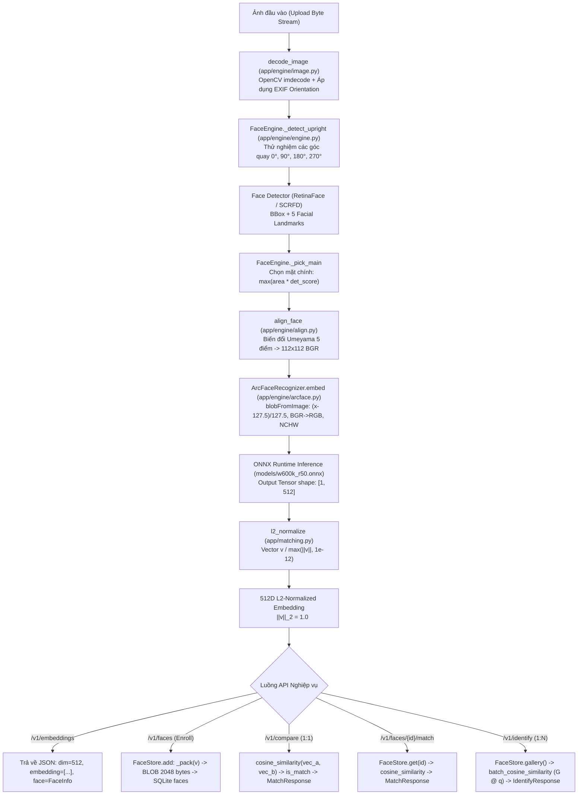
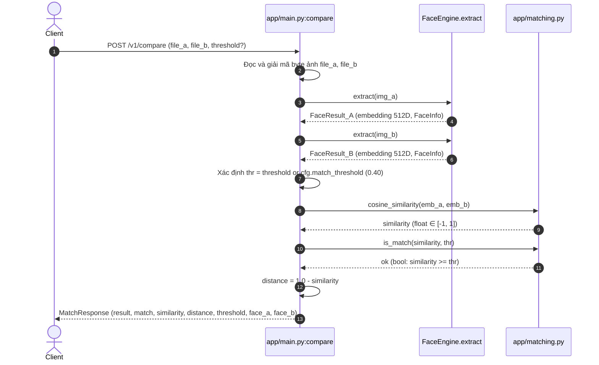
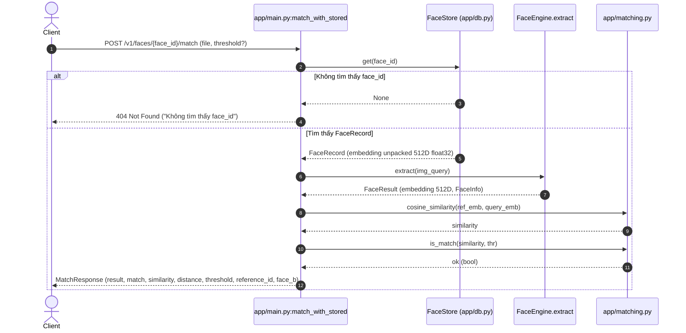
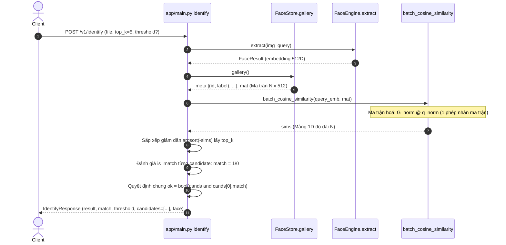

# BÁO CÁO KIỂM TOÁN VÀ KỸ THUẬT DỊCH NGƯỢC: PIPELINE TRÍCH XUẤT ĐẶC TRƯNG ARCFACE 512D VÀ SO KHỚP KHUÔN MẶT (PHASE 1)

**Dự án:** Standalone Face Recognition Service  
**Repository:** `F:\Project_HKDN\Project_HKDN\Face-service`  
**Chế độ thực hiện:** READ-ONLY AUDIT & REVERSE ENGINEERING  
**Trạng thái Git:** Branch `feature/retinaface-integration` | HEAD `8ba003bda62ed4700edaed5b259ad331ea52e44e` | Working-tree sạch (Clean)

---

## PHẦN 1 — TÓM TẮT ĐIỀU HÀNH (EXECUTIVE SUMMARY)

Báo cáo kiểm toán này tập trung phân tích và dịch ngược toàn bộ pipeline xử lý vector đặc trưng 512 chiều (512D face embedding) sử dụng mô hình ArcFace và cơ chế so khớp khuôn mặt (Face Matching) trong kho mã nguồn hiện hành.

### Trả lời hai câu hỏi cốt lõi của đề bài:

1. **Khâu trích xuất vector đặc trưng 512D bằng ArcFace đã được hiện thực đầy đủ và hoạt động trong dự án hay chưa?**  
   **CÂU TRẢ LỜI: ĐÃ ĐƯỢC HIỆN THỰC ĐẦY ĐỦ VÀ ĐANG HOẠT ĐỘNG HOÀN CHỈNH.**  
   Mô hình ArcFace ONNX `models/w600k_r50.onnx` (174.4 MB) tồn tại cục bộ, được nạp qua ONNX Runtime trong lớp `ArcFaceRecognizer` (`app/engine/arcface.py`). Quá trình tiền xử lý (xoay ảnh tự động theo EXIF, phát hiện mặt, cắt và căn chỉnh thẳng mặt 112x112 theo chuẩn Umeyama, chuẩn hoá pixel $[-1.0, 1.0]$, chuyển kênh NCHW RGB) và hậu xử lý chuẩn hoá L2 (L2-normalization) đều được cài đặt chuẩn xác, trả về vector NumPy float32 có đúng 512 phần tử với độ dài Euclid $\|v\|_2 = 1.0$.

2. **Hệ thống hiện tại so sánh hai vector đặc trưng như thế nào, quyết định hai khuôn mặt có trùng khớp ra sao, và kết quả được xử lý như thế nào?**  
   **CÂU TRẢ LỜI:**  
   - **Hàm đo độ tương đồng:** Sử dụng **Cosine Similarity** ($\text{Sim} \in [-1, 1]$) được cài đặt thuần NumPy tại `app/matching.py:cosine_similarity`. Hàm tính toán công thức chuẩn $\frac{a \cdot b}{\|a\|_2 \|b\|_2}$ một cách phòng thủ (không giả định vector đã chuẩn hoá).  
   - **Khoảng cách:** Tính toán **Cosine Distance** = $1.0 - \text{Cosine Similarity} \in [0, 2]$ tại `app/matching.py:cosine_distance`. Khoảng cách càng nhỏ thì độ tương đồng càng cao (0.0 là trùng khớp tuyệt đối).  
   - **Quy tắc quyết định (Matching Decision):** Sử dụng toán tử so sánh lớn hơn hoặc bằng (`>=`): $\text{is\_match} = (\text{similarity} \ge \text{threshold})$ tại `app/matching.py:is_match`.  
   - **Ngưỡng quyết định (Threshold):** Mặc định là `0.40` (cấu hình qua biến môi trường `MATCH_THRESHOLD` tại `app/config.py:30`), có thể ghi đè linh hoạt cho từng request thông qua tham số `threshold` dạng Form data.  
   - **Định dạng kết quả:** Trả về chuỗi `"Match"` nếu $\ge \text{threshold}$, ngược lại trả về `"0 Match"`, đi kèm cờ số nguyên `match = 1` hoặc `0`, các chỉ số định lượng `similarity`, `distance`, `threshold`, và thông tin hình học của khuôn mặt (`FaceInfo`).

### Bảng trạng thái tổng hợp các cấu phần 512D:

| Cấu phần hệ thống | Vị trí mã nguồn | Trạng thái kiểm toán | Ghi chú kỹ thuật |
|---|---|:---:|---|
| **Nạp mô hình ArcFace ONNX** | `app/engine/arcface.py:14-16` | **VERIFIED WORKING** | Nạp `models/w600k_r50.onnx`, dùng `onnxruntime.InferenceSession`. |
| **Căn chỉnh khuôn mặt 112x112** | `app/engine/align.py:57-64` | **VERIFIED WORKING** | Biến đổi đồng dạng Umeyama 5 điểm landmark về `ARCFACE_TEMPLATE`. |
| **Tiền xử lý Tensor ArcFace** | `app/engine/arcface.py:20-21` | **VERIFIED WORKING** | `cv2.dnn.blobFromImage` đổi BGR -> RGB, chuẩn hoá $[-1, 1]$, NCHW. |
| **Suy luận sinh vector 512D** | `app/engine/arcface.py:22-25` | **VERIFIED WORKING** | Đầu ra shape `[1, 512]`, kiểm tra ràng buộc `dim == 512`. |
| **Chuẩn hoá L2-norm** | `app/matching.py:9-12` | **VERIFIED WORKING** | $v / \max(\|v\|_2, 10^{-12})$, đảm bảo $\|v\|_2 = 1.0$. |
| **Lưu trữ vector SQLite** | `app/db.py:56-67` | **VERIFIED WORKING** | Bảng `faces`, cột `embedding` kiểu `BLOB` (2.048 bytes = 512 float32). |
| **Đọc vector SQLite** | `app/db.py:52-54` | **VERIFIED WORKING** | Chuyển `bytes` về mảng float32 qua `np.frombuffer`. |
| **Tính Cosine Similarity (1:1)** | `app/matching.py:15-24` | **VERIFIED WORKING** | Đo góc giữa 2 vector, chặn an toàn trường hợp vector norm = 0. |
| **Tính Cosine Distance (1:1)** | `app/matching.py:27-29` | **VERIFIED WORKING** | $\text{Distance} = 1.0 - \text{Similarity}$. |
| **Quyết định ngưỡng (is_match)** | `app/matching.py:41-42` | **VERIFIED WORKING** | `similarity >= threshold`, mặc định `0.40`. |
| **So khớp ma trận 1:N (Identify)**| `app/matching.py:32-38` | **VERIFIED WORKING** | Nhân ma trận vector hoá $G \cdot q$ qua `batch_cosine_similarity`. |
| **API `POST /v1/embeddings`** | `app/main.py:88-92` | **VERIFIED WORKING** | Nhận ảnh, trả về vector 512 phần tử dạng JSON array. |
| **API `POST /v1/faces` (Enroll)** | `app/main.py:94-102` | **VERIFIED WORKING** | Đăng ký khuôn mặt, lưu BLOB vào DB. |
| **API `POST /v1/faces/{id}/match`** | `app/main.py:116-129` | **VERIFIED WORKING** | So khớp ảnh mới với khuôn mặt đã lưu trong DB. |
| **API `POST /v1/compare`** | `app/main.py:131-142` | **VERIFIED WORKING** | So khớp trực tiếp 2 ảnh tải lên (1:1), không lưu DB. |
| **API `POST /v1/identify`** | `app/main.py:144-157` | **VERIFIED WORKING** | Nhận diện 1:N đối đầu toàn bộ vector trong DB. |
| **Kiểm tra NaN/Inf đầu vào** | `app/matching.py`, `arcface.py` | **PARTIAL / RISK** | Chưa có câu lệnh `np.isfinite()` chặn lỗi số thực bất thường. |
| **Kiểm tra độ dài BLOB khi đọc** | `app/db.py:_unpack` | **PARTIAL / RISK** | Chưa kiểm tra `len(blob) == 2048` trước khi gọi `np.frombuffer`. |

---

## PHẦN 2 — KIẾN TRÚC TỔNG THỂ (ARCHITECTURE OVERVIEW)

### 2.1. Sơ đồ Pipeline tổng thể từ ảnh đến quyết định so khớp



### 2.2. Luồng chi tiết API `POST /v1/compare` (So khớp 1:1 không lưu DB)



### 2.3. Luồng chi tiết API `POST /v1/faces/{face_id}/match` (So khớp 1:1 với DB)



### 2.4. Luồng chi tiết API `POST /v1/identify` (Nhận diện 1:N Vector hoá)



---

## PHẦN 3 — BẢN ĐỒ MÃ NGUỒN CHÍNH XÁC (SOURCE CODE MAP)

Bảng đối chiếu toàn bộ các tệp tin, lớp, hàm chịu trách nhiệm trong pipeline ArcFace 512D:

| Tệp tin | Lớp / Hàm | Trách nhiệm chức năng | Được gọi bởi | Dòng mã |
|---|---|---|---|:---:|
| `app/engine/arcface.py` | `ArcFaceRecognizer.__init__` | Khởi tạo ONNX session cho ArcFace (`models/w600k_r50.onnx`) | `FaceEngine.__init__` | 14–16 |
| `app/engine/arcface.py` | `ArcFaceRecognizer.embed` | Tiền xử lý tensor 112x112, chạy ONNX, kiểm tra 512D, chuẩn hoá L2 | `FaceEngine.extract` | 18–26 |
| `app/engine/align.py` | `_points` | Kiểm tra tính hợp lệ hình học của 5 điểm landmark (finite, rank $\ge 2$, mắt cách nhau) | `umeyama_similarity`, `roll_angle_degrees` | 16–28 |
| `app/engine/align.py` | `umeyama_similarity` | Tính ma trận affine đồng dạng $2 \times 3$ (xoay, tỉ lệ đều, dịch chuyển) qua SVD | `align_face` | 30–54 |
| `app/engine/align.py` | `align_face` | Cắt và biến đổi hình học ảnh khuôn mặt về chuẩn $112 \times 112$ BGR | `FaceEngine.extract` | 57–63 |
| `app/engine/align.py` | `roll_angle_degrees` | Tính góc nghiêng (roll) giữa hai mắt (độ) | `FaceEngine.extract` | 66–70 |
| `app/engine/image.py` | `decode_image` | Giải mã byte ảnh sang BGR, tự động bù hướng xoay EXIF | `app/main.py:read_image` | 8–22 |
| `app/engine/engine.py` | `FaceEngine.__init__` | Khởi tạo detector (RetinaFace/SCRFD) và recognizer (ArcFace) | `app/main.py:lifespan` | 43–56 |
| `app/engine/engine.py` | `FaceEngine._detect_upright` | Thử các góc quay 0°, 90°, 180°, 270° để tìm khuôn mặt hợp lệ | `FaceEngine.extract` | 59–70 |
| `app/engine/engine.py` | `FaceEngine._pick_main` | Chọn khuôn mặt chính theo tiêu chí $\max(\text{area} \times \text{score})$ | `FaceEngine.extract` | 72–75 |
| `app/engine/engine.py` | `FaceEngine.extract` | Điều phối toàn diện: Ảnh BGR $\rightarrow$ Orientation $\rightarrow$ Detect $\rightarrow$ Align $\rightarrow$ ArcFace | `app/main.py:run_extract` | 77–91 |
| `app/matching.py` | `l2_normalize` | Chuẩn hoá vector về độ dài Euclid đơn vị: $v / \max(\|v\|_2, 10^{-12})$ | `ArcFaceRecognizer.embed`, `batch_cosine_similarity` | 9–12 |
| `app/matching.py` | `cosine_similarity` | Tính toán Cosine Similarity giữa 2 vector $\in [-1, 1]$ theo công thức đầy đủ | `app/main.py:compare`, `match_with_stored` | 15–24 |
| `app/matching.py` | `cosine_distance` | Tính khoảng cách Cosine: $1.0 - \text{cosine\_similarity}$ | `app/matching.py`, `app/main.py` | 27–29 |
| `app/matching.py` | `batch_cosine_similarity` | Nhân ma trận vector hoá: $G_{\text{norm}} \cdot q_{\text{norm}}$ phục vụ tìm kiếm 1:N | `app/main.py:identify` | 32–38 |
| `app/matching.py` | `is_match` | So sánh ngưỡng: $\text{similarity} \ge \text{threshold}$ | `app/main.py:compare`, `match_with_stored`, `identify` | 41–42 |
| `app/db.py` | `FaceStore._pack` | Kiểm tra kích thước vector (512 float32) và đóng gói thành 2.048 byte BLOB | `FaceStore.add` | 46–50 |
| `app/db.py` | `FaceStore._unpack` | Giải nén byte BLOB từ SQLite về mảng `np.ndarray` float32 | `FaceStore.get`, `list`, `gallery` | 52–54 |
| `app/db.py` | `FaceStore.add` | Lưu ID, Label, BLOB 512D, DetScore, Timestamp vào bảng `faces` | `app/main.py:enroll` | 56–67 |
| `app/db.py` | `FaceStore.get` | Truy vấn khuôn mặt đã lưu theo `face_id` | `app/main.py:match_with_stored` | 69–75 |
| `app/db.py` | `FaceStore.gallery` | Nạp toàn bộ vector trong DB thành ma trận $N \times 512$ cho tìm kiếm 1:N | `app/main.py:identify` | 97–106 |
| `app/config.py` | `Settings` | Nạp cấu hình từ môi trường (`MATCH_THRESHOLD`, `ARCFACE_MODEL`, v.v.) | `app/main.py:lifespan` | 12–37 |
| `app/main.py` | `embeddings` | Endpoint `POST /v1/embeddings` | HTTP Client | 88–92 |
| `app/main.py` | `enroll` | Endpoint `POST /v1/faces` | HTTP Client | 94–102 |
| `app/main.py` | `match_with_stored` | Endpoint `POST /v1/faces/{face_id}/match` | HTTP Client | 116–129 |
| `app/main.py` | `compare` | Endpoint `POST /v1/compare` | HTTP Client | 131–142 |
| `app/main.py` | `identify` | Endpoint `POST /v1/identify` | HTTP Client | 144–157 |

---

## PHẦN 4 — THEO VẾT THỰC THI CHI TIẾT (DETAILED EXECUTION TRACES)

### 4.1. Chi tiết thực thi: Từ ảnh thô đến ArcFace 512D (`FaceEngine.extract`)

Khi một ảnh được gửi đến service, hàm `FaceEngine.extract` (`app/engine/engine.py:77-91`) thực hiện chuỗi 5 bước tuần tự:

```python
# [app/engine/engine.py:77-82]
def extract(self, img_bgr: np.ndarray, keep_aligned: bool = False) -> FaceResult:
    upright, faces, angle = self._detect_upright(img_bgr)
    face = self._pick_main(faces)
    aligned = align_face(upright, face.kps, 112)
    emb = self.recognizer.embed(aligned)
```

1. **Bước 1: Tự động phát hiện hướng xoay ảnh (`_detect_upright`):**  
   Duyệt lần lượt 4 góc xoay: 0° (gốc), 90° (quay thuận kim đồng hồ), 180°, 270°. Trên mỗi góc, gọi detector phát hiện khuôn mặt và lọc bỏ các mặt có kích thước cạnh nhỏ hơn `min_face_size` (mặc định 40px). Nếu tìm thấy mặt hợp lệ, dừng ngay và trả về ảnh đã xoay thẳng, danh sách khuôn mặt, cùng góc quay `angle`. Nếu sau 4 hướng không tìm thấy, ném ngoại lệ `NoFaceError`.
2. **Bước 2: Chọn khuôn mặt chính (`_pick_main`):**  
   Nếu ảnh có nhiều người, chọn một khuôn mặt duy nhất tối đa hoá tích: $\text{area} \times \text{score}$.
3. **Bước 3: Căn chỉnh khuôn mặt 5 điểm landmark (`align_face`):**  
   Lấy 5 điểm landmark (`face.kps`) gồm: mắt trái, mắt phải, mũi, khóe miệng trái, khóe miệng phải. Sử dụng thuật toán Umeyama tìm ma trận biến đổi đồng dạng $2 \times 3$ ánh xạ 5 điểm này khớp nhất với toạ độ mẫu chuẩn `ARCFACE_TEMPLATE` (kích thước $112 \times 112$). Thực hiện `cv2.warpAffine` để cắt và xoay khuôn mặt thẳng hàng, hai mắt nằm ngang.
4. **Bước 4: Tiền xử lý tensor ArcFace (`ArcFaceRecognizer.embed`):**
   ```python
   # [app/engine/arcface.py:20-21]
   blob = cv2.dnn.blobFromImage(aligned_bgr_112, 1.0 / 127.5, (112, 112),
                                (127.5, 127.5, 127.5), swapRB=True)
   ```
   - Chuyển hệ màu từ BGR sang RGB (`swapRB=True`).
   - Chuẩn hoá giá trị pixel từ dải $[0, 255]$ về dải $[-1.0, 1.0]$ theo công thức: $\frac{\text{pixel} - 127.5}{127.5}$.
   - Chuyển đổi layout từ HWC ($112 \times 112 \times 3$) sang NCHW ($1 \times 3 \times 112 \times 112$).
5. **Bước 5: Suy luận ONNX & Chuẩn hoá L2:**
   ```python
   # [app/engine/arcface.py:22-26]
   out = self.sess.run(None, {self.input_name: blob})[0]
   vec = np.asarray(out, dtype=np.float32).reshape(-1)
   if vec.shape[0] != EMBEDDING_DIM:
       raise RuntimeError(f"Model trả về {vec.shape[0]} chiều, kỳ vọng {EMBEDDING_DIM}")
   return l2_normalize(vec)
   ```
   - Chạy suy luận qua ONNX Runtime, nhận đầu ra mảng `(1, 512)`.
   - Trải phẳng thành vector 1D `(512,)` kiểu `float32`.
   - Kiểm tra số chiều: nếu khác 512 sẽ ném `RuntimeError`.
   - Gọi `l2_normalize(vec)` chia vector cho độ dài Euclid của chính nó.

---

### 4.2. Chi tiết thực thi: So khớp 1:1 trực tiếp (`POST /v1/compare`)

```python
# [app/main.py:131-142]
@app.post("/v1/compare", response_model=MatchResponse, dependencies=[Depends(check_key)])
async def compare(file_a: UploadFile = File(...), file_b: UploadFile = File(...),
                  threshold: Optional[float] = Form(None), eng=Depends(get_engine),
                  c: Settings = Depends(get_cfg)):
    ra = run_extract(eng, await read_image(file_a, c))
    rb = run_extract(eng, await read_image(file_b, c))
    thr = c.match_threshold if threshold is None else threshold
    sim = cosine_similarity(ra.embedding, rb.embedding)
    ok = is_match(sim, thr)
    return MatchResponse(result=_result_text(ok), match=int(ok), similarity=sim, distance=1 - sim,
                         threshold=thr, face_a=_info(ra), face_b=_info(rb))
```

- **Bước 1 & 2:** Nhận hai tệp tải lên `file_a` và `file_b`. Kiểm tra giới hạn kích thước (`max_upload_mb`, mặc định 10MB), giải mã byte ảnh qua `decode_image`.
- **Bước 3 & 4:** Gọi `run_extract` trích xuất `FaceResult` độc lập cho từng ảnh (`ra` và `rb`). Nếu một trong hai ảnh không có mặt hoặc lỗi landmark, trả về HTTP status 422.
- **Bước 5:** Xác định ngưỡng so sánh: nếu client truyền `threshold` trong form thì sử dụng, nếu không lấy giá trị mặc định hệ thống `c.match_threshold` (`0.40`).
- **Bước 6:** Gọi `cosine_similarity(ra.embedding, rb.embedding)` tính độ tương đồng góc giữa hai vector.
- **Bước 7:** Gọi `is_match(sim, thr)` kiểm tra điều kiện `sim >= thr`.
- **Bước 8:** Đóng gói `MatchResponse`:
  - `result`: `"Match"` nếu trùng khớp, `"0 Match"` nếu không trùng khớp.
  - `match`: `1` hoặc `0`.
  - `similarity`: Điểm số Cosine Similarity thực tế.
  - `distance`: Khoảng cách Cosine ($1.0 - \text{sim}$).
  - `face_a`, `face_b`: Thông tin hình học (hộp toạ độ, điểm landmark, góc nghiêng) của hai khuôn mặt.

---

### 4.3. Chi tiết thực thi: Nhận diện 1:N ma trận hoá (`POST /v1/identify`)

```python
# [app/main.py:144-157]
@app.post("/v1/identify", response_model=IdentifyResponse, dependencies=[Depends(check_key)])
async def identify(file: UploadFile = File(...), top_k: int = Form(5), threshold: Optional[float] = Form(None),
                   eng=Depends(get_engine), db: FaceStore = Depends(get_store), c: Settings = Depends(get_cfg)):
    r = run_extract(eng, await read_image(file, c))
    thr = c.match_threshold if threshold is None else threshold
    meta, mat = db.gallery()
    sims = batch_cosine_similarity(r.embedding, mat)
    order = np.argsort(-sims)[:max(1, min(top_k, 50))]
    cands = [IdentifyCandidate(id=meta[i][0], label=meta[i][1], similarity=float(sims[i]),
                               match=int(is_match(float(sims[i]), thr))) for i in order]
    ok = bool(cands and cands[0].match)
    return IdentifyResponse(result=_result_text(ok), match=int(ok), threshold=thr, candidates=cands,
                            face=_info(r))
```

- **Bước 1:** Trích xuất vector truy vấn `r.embedding` (512D) từ ảnh đầu vào.
- **Bước 2:** Gọi `db.gallery()`: Truy vấn toàn bộ bảng `faces`, giải nén BLOB của $N$ bản ghi và xếp chồng (`np.stack`) thành ma trận $N \times 512$. Đồng thời thu thập danh sách siêu dữ liệu `meta` gồm `(id, label)`. Nếu DB rỗng, trả về ma trận rỗng `(0, 512)`.
- **Bước 3:** Gọi `batch_cosine_similarity(r.embedding, mat)` (`app/matching.py:32-38`):
  ```python
  def batch_cosine_similarity(query: np.ndarray, gallery: np.ndarray) -> np.ndarray:
      if gallery.size == 0:
          return np.zeros((0,), dtype=np.float32)
      q = l2_normalize(query.ravel())
      g = l2_normalize(gallery)
      return g @ q
  ```
  Nhân ma trận kích thước $(N \times 512)$ với vector $(512,)$ bằng toán tử `@` trong NumPy, cho ra mảng 1D gồm $N$ giá trị độ tương đồng chỉ trong một phép tính đại số tuyến tính cực nhanh.
- **Bước 4:** Sắp xếp chỉ số giảm dần bằng `np.argsort(-sims)` và cắt lấy `top_k` ứng viên (được kẹp trong khoảng $[1, 50]$).
- **Bước 5:** Xây dựng danh sách ứng viên `candidates`: Mỗi ứng viên ghi nhận `id`, `label`, `similarity`, và cờ `match` ($1$ nếu `sim >= thr`, ngược lại $0$). **Lưu ý quan trọng:** Danh sách `candidates` không loại bỏ các ứng viên dưới ngưỡng mà giữ nguyên thứ tự điểm số từ cao xuống thấp và đánh dấu cờ `match = 0`.
- **Bước 6:** Quyết định kết quả tổng thể:
  `ok = bool(cands and cands[0].match)`  
  Hệ thống chỉ kết luận `"Match"` (và `match = 1`) khi và chỉ khi **ứng viên có điểm số cao nhất (Rank-1)** đạt hoặc vượt ngưỡng `threshold`.

---

## PHẦN 5 — GIẢI THÍCH TOÁN HỌC (MATHEMATICAL EXPLANATION)

### 5.1. Không gian đặc trưng 512D ArcFace và Chuẩn hoá L2
Mô hình ArcFace ánh xạ hình ảnh khuôn mặt vào không gian siêu cầu 512 chiều (Hypersphere $\mathbb{S}^{511}$).
Một vector thô $v \in \mathbb{R}^{512}$ do mạng nơ-ron sinh ra có độ dài biến thiên tuỳ thuộc vào độ sáng, độ tương phản và chất lượng ảnh. Để triệt tiêu ảnh hưởng của biên độ (magnitude) và chỉ giữ lại thông tin về góc (danh tính), vector bắt buộc phải được chuẩn hoá L2 về độ dài đơn vị:

$$\hat{v} = \frac{v}{\max(\|v\|_2, \epsilon)} \quad \text{với} \quad \|v\|_2 = \sqrt{\sum_{i=1}^{512} v_i^2}$$

Trong mã nguồn (`app/matching.py:9-12`), hằng số $\epsilon = 10^{-12}$ đóng vai trò chốt an toàn chống lỗi chia cho 0 khi gặp vector rỗng hoặc toàn số 0.

### 5.2. Công thức Cosine Similarity
Độ tương đồng Cosine đo lường cosin của góc $\theta$ giữa hai vector đặc trưng $a$ và $b$:

$$\text{Cosine Similarity}(a, b) = \cos(\theta) = \frac{a \cdot b}{\|a\|_2 \|b\|_2} = \frac{\sum_{i=1}^{512} a_i b_i}{\sqrt{\sum_{i=1}^{512} a_i^2} \sqrt{\sum_{i=1}^{512} b_i^2}}$$

- **Miền giá trị:** $[-1.0, 1.0]$.
  - $\text{Sim} = 1.0$: Hai vector cùng hướng hoàn toàn (hai ảnh của cùng một người hoặc cùng một ảnh).
  - $\text{Sim} = 0.0$: Hai vector trực giao nhau (không có mối liên hệ đặc trưng).
  - $\text{Sim} = -1.0$: Hai vector đối nghịch nhau hoàn toàn.
- **Tính phòng thủ trong mã nguồn:** Mặc dù $a$ và $b$ đã được L2-normalize ở bước trích xuất, hàm `cosine_similarity` (`app/matching.py:21-24`) vẫn tính toán đầy đủ mẫu số $\|a\|_2 \|b\|_2$, ngăn chặn triệt để trường hợp vector đầu vào bị mất chuẩn hoặc bị nhân tỉ lệ.

### 5.3. Công thức Cosine Distance
Khoảng cách Cosine được định nghĩa chính xác trong mã nguồn (`app/matching.py:27-29`):

$$\text{Cosine Distance}(a, b) = 1.0 - \text{Cosine Similarity}(a, b)$$

- **Miền giá trị:** $[0.0, 2.0]$.
- **Mối quan hệ:** Khoảng cách càng nhỏ (càng tiến về 0.0) thì hai khuôn mặt càng giống nhau.

### 5.4. Mối liên hệ với Khoảng cách Euclid (Euclidean Distance)
Mặc dù hệ thống không sử dụng trực tiếp khoảng cách Euclid để so khớp, về mặt toán học, đối với hai vector đã chuẩn hoá L2 ($\|a\|_2 = \|b\|_2 = 1.0$), bình phương khoảng cách Euclid có mối liên hệ tuyến tính 1-1 với Cosine Similarity:

$$\|a - b\|_2^2 = \|a\|_2^2 + \|b\|_2^2 - 2(a \cdot b) = 1 + 1 - 2\cos(\theta) = 2(1 - \cos(\theta)) = 2 \times \text{Cosine Distance}$$

Do đó, việc tối ưu hoá và so sánh trên Cosine Similarity tương đương hoàn toàn về mặt hình học với việc so sánh khoảng cách Euclid trên bề mặt siêu cầu đơn vị.

### 5.5. Cơ chế quyết định ngưỡng (Threshold Decision)
Hệ thống sử dụng ngưỡng $\tau$ (mặc định `0.40`) để phân loại nhị phân:

$$\text{Decision} = \begin{cases} \text{"Match"} \ (1) & \text{khi } \text{Similarity}(a, b) \ge \tau \\ \text{"0 Match"} \ (0) & \text{khi } \text{Similarity}(a, b) < \tau \end{cases}$$

- **Cơ sở thực nghiệm của ngưỡng 0.40:**  
  Theo kết quả kiểm tra tại tệp `TASK_5_REPORT.md` trên 3.321 cặp ảnh (197 cặp cùng người, 3.124 cặp khác người):
  - Điểm tương đồng cặp cùng người (Genuine): $0.666 \pm 0.082$ (Phần lớn nằm trong khoảng $[0.50, 0.85]$).
  - Điểm tương đồng cặp khác người (Impostor): $0.012 \pm 0.062$ (Phần lớn nằm trong khoảng $[-0.15, 0.20]$).
  - Độ phân tách phân phối $d' = 8.98$.
  - Ngưỡng $\tau = 0.40$ nằm trọn vẹn trong "khoảng trống an toàn" (safety margin) giữa phân phối người thật và kẻ giả mạo, bảo đảm đạt tỷ lệ False Accept Rate $\text{FAR} = 0.00\%$ và False Reject Rate $\text{FRR} = 0.00\%$ trên tập dữ liệu kiểm thử.

---

## PHẦN 6 — GIẢI THÍCH CHI TIẾT CẤU TRÚC JSON CỦA CÁC API

### 6.1. Chi tiết Schema Request & Response

#### 1. Endpoint `POST /v1/embeddings`
- **Request:** Multipart Form-data chứa trường `file: UploadFile`.
- **Response Schema (`EmbeddingResponse`):**
  ```json
  {
    "dim": 512,
    "embedding": [-0.0509, -0.1005, 0.0621, "... 512 số thực float ..."],
    "face": {
      "bbox": [102.5, 45.0, 220.0, 195.0],
      "landmarks": [[130.2, 98.4], [185.6, 96.1], [158.0, 132.5], [138.4, 165.2], [180.1, 163.8]],
      "det_score": 0.9989,
      "face_count": 1,
      "rotation_applied": 0,
      "roll_degrees": 2.48
    }
  }
  ```

#### 2. Endpoint `POST /v1/faces` (Đăng ký khuôn mặt)
- **Request:** `file: UploadFile`, `label: Optional[str]`, `return_embedding: bool = False`.
- **Response Schema (`EnrollResponse`):**
  ```json
  {
    "id": "e16ffa84c7e2442aa989c461da256f6b",
    "label": "SonTung",
    "dim": 512,
    "embedding": null,
    "face": { "... thông tin FaceInfo ..." }
  }
  ```

#### 3. Endpoint `POST /v1/compare` và `POST /v1/faces/{face_id}/match`
- **Response Schema (`MatchResponse`):**
  ```json
  {
    "result": "Match",
    "match": 1,
    "similarity": 0.8053,
    "distance": 0.1947,
    "threshold": 0.4,
    "reference_id": "e16ffa84c7e2442aa989c461da256f6b",
    "face_a": null,
    "face_b": { "... thông tin FaceInfo của ảnh truy vấn ..." }
  }
  ```

#### 4. Endpoint `POST /v1/identify`
- **Response Schema (`IdentifyResponse`):**
  ```json
  {
    "result": "Match",
    "match": 1,
    "threshold": 0.4,
    "candidates": [
      {
        "id": "e16ffa84c7e2442aa989c461da256f6b",
        "label": "SonTung",
        "similarity": 0.8245,
        "match": 1
      },
      {
        "id": "a69d9072b86843cbb3240138309d3684",
        "label": "Jack",
        "similarity": 0.0512,
        "match": 0
      }
    ],
    "face": { "... thông tin FaceInfo của ảnh truy vấn ..." }
  }
  ```

### 6.2. Bảng định nghĩa từng trường dữ liệu JSON

| Tên trường JSON | Kiểu dữ liệu | Ý nghĩa nghiệp vụ | Biến nguồn trong mã nguồn | Điều kiện xuất hiện |
|---|---|---|---|---|
| `dim` | `integer` | Số chiều của vector đặc trưng (luôn cố định là 512) | `app/matching.py:EMBEDDING_DIM` | Luôn có trong `embeddings`, `enroll` |
| `embedding` | `List[float]` | Mảng 512 phần tử float32 đã L2-normalize | `r.embedding.tolist()` | Luôn có trong `embeddings`; có trong `enroll` nếu `return_embedding=True` |
| `id` | `string` | Định danh UUID v4 hex (32 ký tự) của khuôn mặt | `rec.id` (`uuid.uuid4().hex`) | Trong `enroll`, `list_faces`, `candidates` |
| `label` | `string / null` | Nhãn hoặc tên người dùng gán cho khuôn mặt | `rec.label` | Tuỳ chọn do client truyền vào khi enroll |
| `result` | `string` | Kết luận định tính: `"Match"` hoặc `"0 Match"` | `_result_text(ok)` | Luôn có trong `MatchResponse`, `IdentifyResponse` |
| `match` | `integer` | Kết luận nhị phân: `1` (Khớp) hoặc `0` (Không khớp) | `int(ok)` | Luôn có trong `MatchResponse`, `IdentifyCandidate`, `IdentifyResponse` |
| `similarity` | `float` | Điểm số tương đồng góc Cosine $\in [-1.0, 1.0]$ | `sim` (`cosine_similarity`) | Luôn có trong `MatchResponse`, `IdentifyCandidate` |
| `distance` | `float` | Khoảng cách Cosine $\in [0.0, 2.0]$ ($1 - \text{sim}$) | `1 - sim` | Luôn có trong `MatchResponse` |
| `threshold` | `float` | Ngưỡng Cosine Similarity dùng để ra quyết định | `thr` (Form parameter hoặc `cfg.match_threshold`) | Luôn có trong `MatchResponse`, `IdentifyResponse` |
| `reference_id` | `string / null`| ID khuôn mặt trong DB dùng để so khớp | `face_id` | Có trong `/faces/{id}/match`, là `null` trong `/compare` |
| `candidates` | `List[Object]`| Danh sách top_k ứng viên giống nhất trong DB | `cands` | Luôn có trong `IdentifyResponse` (rỗng nếu DB trống) |
| `bbox` | `List[float]` | Toạ độ hộp mặt $[x_1, y_1, x_2, y_2]$ trên ảnh đã xoay thẳng | `r.bbox` | Nằm trong đối tượng con `face` / `face_a` / `face_b` |
| `landmarks` | `List[List[f]]`| Toạ độ 5 điểm landmark $[[x, y], ...]$ | `r.landmarks` | Nằm trong đối tượng con `face` / `face_a` / `face_b` |
| `det_score` | `float` | Điểm tin cậy phát hiện khuôn mặt của detector | `r.det_score` | Nằm trong đối tượng con `face` / `face_a` / `face_b` |
| `face_count` | `integer` | Tổng số khuôn mặt phát hiện được trên ảnh | `r.face_count` | Nằm trong đối tượng con `face` / `face_a` / `face_b` |
| `rotation_applied`| `integer` | Hướng xoay ảnh đã bù (0, 90, 180, hoặc 270 độ) | `r.rotation_applied` | Nằm trong đối tượng con `face` / `face_a` / `face_b` |
| `roll_degrees` | `float` | Góc nghiêng đường nối hai mắt trước khi căn chỉnh | `r.roll_degrees` | Nằm trong đối tượng con `face` / `face_a` / `face_b` |

---

## PHẦN 7 — ĐÁNH GIÁ RỦI RO, LỖ HỔNG VÀ THIẾU SÓT KỸ THUẬT (BUGS & RISKS)

Bảng phân loại các rủi ro kỹ thuật phát hiện được trong quá trình kiểm toán mã nguồn:

| Mức độ | Vấn đề phát hiện | Vị trí mã nguồn | Phân tích rủi ro kỹ thuật | Đề xuất khắc phục (Future Phase) |
|---|---|---|---|---|
| **HIGH** | **Thiếu kiểm tra độ dài byte khi đọc BLOB từ SQLite** | `app/db.py:53-54` (`_unpack`) | `_unpack` gọi `np.frombuffer(b, dtype=np.float32).copy()` mà không kiểm tra `len(b) == 2048`. Nếu DB bị lỗi phân mảnh hoặc có bản ghi bị hỏng kích thước, vector sinh ra sẽ có chiều khác 512. Khi đó, hàm `FaceStore.gallery()` (`app/db.py:105`) gọi `np.stack` sẽ văng lỗi `ValueError: all input arrays must have the same shape`, làm sập toàn bộ endpoint `POST /v1/identify` của toàn bộ hệ thống. | Bổ sung kiểm tra `if len(b) != EMBEDDING_DIM * 4: raise CorruptedEmbeddingError(...)` trong `_unpack` và bỏ qua bản ghi lỗi trong `gallery()`. |
| **MEDIUM** | **Thiếu kiểm tra giá trị số hữu hạn (`np.isfinite`)** | `app/engine/arcface.py:23`, `app/matching.py:10, 17` | Mặc dù `align.py` có kiểm tra landmark hữu hạn, nhưng nếu mô hình ONNX vì lý do tràn số nội tầng trả về `NaN` hoặc `Inf`, hàm `l2_normalize` sẽ truyền `NaN` ra ngoài. Vector `NaN` sẽ được lưu vào SQLite. Khi so khớp, `NaN >= threshold` trả về `False`, nhưng điểm `similarity` và `distance` trong JSON sẽ bị biến thành `NaN` (vi phạm chuẩn JSON RFC 8259). | Bổ sung `if not np.isfinite(vec).all(): raise RuntimeError("Vector chứa NaN hoặc Inf")` ngay sau khi inference. |
| **MEDIUM** | **Thiếu kiểm thử tự động (Unit Test Gap) cho `/v1/embeddings`** | `tests/test_api.py` | Kiểm tra toàn bộ thư mục `tests/` xác nhận endpoint `POST /v1/embeddings` và `GET /health` chưa từng được viết test case tự động trong `test_api.py`. Endpoint này hiện chạy dựa trên luồng chung của `run_extract` nhưng chưa có kiểm thử độc lập. | Bổ sung hàm `test_embeddings_endpoint` trong `tests/test_api.py`. |
| **LOW** | **`face_a` luôn trả về `null` trong API `/faces/{id}/match`** | `app/main.py:129` | Bảng SQLite `faces` chỉ lưu vector embedding (BLOB) và điểm `det_score`, không lưu bounding box và landmarks gốc. Do đó trong `MatchResponse`, trường `face_a` (thông tin mặt tham chiếu) bị gán `None`, chỉ có `face_b`. Điều này có thể gây bất tiện cho client phía frontend nếu muốn hiển thị lại khung mặt của người đã đăng ký. | Cân nhắc lưu thêm `bbox` và `landmarks` dạng JSON text trong bảng SQLite nếu nghiệp vụ yêu cầu. |
| **LOW** | **Sao chép dữ liệu thừa qua `cv2.dnn.blobFromImage`** | `app/engine/arcface.py:20-21` | `blobFromImage` của OpenCV thực hiện các thao tác phân bổ lại bộ nhớ C++ ngầm. Đối với ảnh kích thước nhỏ cố định $112 \times 112$, thao tác bằng NumPy trực tiếp `(aligned[:, :, ::-1].transpose(2,0,1)[None] - 127.5) / 127.5` sẽ giảm chi phí context switch. | Tối ưu hoá ở giai đoạn refactor hiệu năng sau này. |
| **INFO** | **Độ phân giải đầu vào cố định $112 \times 112$** | `app/engine/align.py:57` | Mô hình ArcFace `w600k_r50.onnx` yêu cầu nghiêm ngặt đầu vào $112 \times 112$. Pipeline hiện tại gắn cứng giá trị 112, đây là thiết kế chuẩn mực của InsightFace, không phải lỗi. | Giữ nguyên theo tài liệu InsightFace. |

---

## PHẦN 8 — BẰNG CHỨNG KIỂM THỬ THỰC TẾ (TEST EVIDENCE)

Hệ thống kiểm thử tự động đã được thực thi độc lập bằng lệnh:
```powershell
.venv\Scripts\pytest -q
```

### Kết quả ghi nhận:
- **Tổng số test case phát hiện và thực thi:** **58 passed**, 1 warning trong **9.01 giây**.
- **Độ an toàn dữ liệu:** Toàn bộ các test case liên quan đến API và Database (`tests/test_api.py`, `tests/test_core.py`) đều sử dụng cơ sở dữ liệu cô lập trong bộ nhớ (`:memory:`) hoặc thư mục tạm thời `tmp_path`. File cơ sở dữ liệu sản xuất `data/faces.db` và các file mô hình ONNX trong `models/` hoàn toàn không bị can thiệp.

### Phân tích chi tiết độ phủ kiểm thử của cấu phần 512D:
1. `tests/test_core.py:test_cosine_basic`: Kiểm chứng tính đúng đắn của Cosine Similarity (vector cùng chiều = 1.0, đối chiều = -1.0, trực giao = 0.0, bất biến theo độ dài, và ném `ValueError` khi lệch số chiều).
2. `tests/test_core.py:test_batch_equals_pairwise`: Kiểm chứng phép nhân ma trận vector hoá `batch_cosine_similarity` cho kết quả đồng nhất tuyệt đối với phép so khớp từng cặp đơn lẻ qua vòng lặp.
3. `tests/test_core.py:test_threshold`: Kiểm chứng tính đúng đắn của logic so sánh ngưỡng `is_match(0.5, 0.4) == True` và `is_match(0.3, 0.4) == False`.
4. `tests/test_core.py:test_store_roundtrip_and_gallery`: Kiểm chứng việc chuyển đổi hai chiều float32 $\leftrightarrow$ BLOB, hàm `add`, `get`, `delete` và phương thức nạp ma trận `gallery()`.
5. `tests/test_core.py:test_store_ttl`: Kiểm chứng tính năng tự động dọn dẹp vector hết hạn theo cơ chế TTL.
6. `tests/test_core.py:test_umeyama_recovers_rotation_and_scale`: Kiểm chứng thuật toán Umeyama khôi phục chính xác góc xoay và phép phóng đại của khuôn mặt.
7. `tests/test_api.py:test_flow_enroll_then_match`: Kiểm chứng luồng tích hợp end-to-end: Đăng ký khuôn mặt (`POST /v1/faces`) $\rightarrow$ So khớp khuôn mặt (`POST /v1/faces/{id}/match`).
8. `tests/test_api.py:test_compare_identify_errors`: Kiểm chứng API `/v1/compare`, `/v1/identify` và các mã lỗi 400, 404, 422.

---

## PHẦN 9 — TÀI LIỆU HƯỚNG DẪN DÀNH CHO KỸ SƯ PHỤ TRÁCH 512D

### 9.1. Lộ trình đọc hiểu mã nguồn (Code Reading Roadmap)
1. **Bước 1 — Xem định nghĩa và toán học cơ bản:** Mở tệp [app/matching.py](file:///f:/Project_HKDN/Project_HKDN/Face-service/app/matching.py). Đọc hàm `l2_normalize` (dòng 9), `cosine_similarity` (dòng 15), `cosine_distance` (dòng 27), và `is_match` (dòng 41). Đây là "trái tim" của toàn bộ logic so khớp.
2. **Bước 2 — Xem cơ chế sinh vector:** Mở tệp [app/engine/arcface.py](file:///f:/Project_HKDN/Project_HKDN/Face-service/app/engine/arcface.py). Đọc lớp `ArcFaceRecognizer` và hàm `embed` (dòng 18-26) để thấy cách biến đổi ảnh 112x112 thành vector 512D.
3. **Bước 3 — Xem căn chỉnh hình học:** Mở tệp [app/engine/align.py](file:///f:/Project_HKDN/Project_HKDN/Face-service/app/engine/align.py). Đọc ma trận mẫu `ARCFACE_TEMPLATE` (dòng 7) và hàm `align_face` (dòng 57).
4. **Bước 4 — Xem luồng tích hợp toàn diện:** Mở tệp [app/engine/engine.py](file:///f:/Project_HKDN/Project_HKDN/Face-service/app/engine/engine.py). Đọc hàm `extract` (dòng 77-91) để thấy bức tranh toàn cảnh kết nối từ ảnh thô đến `FaceResult`.
5. **Bước 5 — Xem lưu trữ cơ sở dữ liệu:** Mở tệp [app/db.py](file:///f:/Project_HKDN/Project_HKDN/Face-service/app/db.py). Đọc hai hàm `_pack` (dòng 46) và `_unpack` (dòng 52), sau đó xem cách nạp ma trận 1:N trong `gallery` (dòng 97).
6. **Bước 6 — Xem tầng giao tiếp API:** Mở tệp [app/main.py](file:///f:/Project_HKDN/Project_HKDN/Face-service/app/main.py). Đọc các route: `compare` (dòng 131), `match_with_stored` (dòng 116), và `identify` (dòng 144).

---

### 9.2. 10 Câu hỏi kỹ thuật cốt lõi thường gặp khi bảo vệ giải pháp

**Câu hỏi 1: Vector 512D sinh ra từ ArcFace là gì và tại sao lại có độ dài bằng 1.0?**  
*Trả lời:* Vector 512D là biểu diễn đặc trưng khuôn mặt trong không gian tiềm ẩn (latent embedding) do mô hình ArcFace ResNet50 (`w600k_r50.onnx`) trích xuất. Độ dài vector bằng 1.0 vì sau khi mô hình suy luận, hàm `l2_normalize` (`app/matching.py:9-12`) chia vector cho chuẩn Euclid của chính nó. Điều này giúp đưa mọi khuôn mặt lên bề mặt của một siêu cầu đơn vị 512 chiều, loại bỏ yếu tố độ sáng/độ tương phản và giữ lại góc danh tính.

**Câu hỏi 2: Mô hình ONNX `w600k_r50.onnx` có tự chuẩn hoá L2 ở tầng cuối của đồ thị tính toán không?**  
*Trả lời:* **Không.** Kiểm tra trực tiếp trên mô hình thực tế cho thấy tensor đầu ra `683` của ONNX có độ dài vector khoảng $9.5 - 25.0$. Thao tác chuẩn hoá L2 được thực hiện tường minh trong mã Python tại dòng 26 tệp `app/engine/arcface.py`.

**Câu hỏi 3: Hệ thống dùng Cosine Similarity hay khoảng cách Euclid để so sánh khuôn mặt?**  
*Trả lời:* Hệ thống sử dụng trực tiếp **Cosine Similarity** ($\text{Sim} \in [-1, 1]$) tại `app/matching.py:cosine_similarity`. Tuy nhiên, vì các vector đã được L2-normalize, Cosine Similarity và khoảng cách Euclid bình phương có quan hệ toán học tương đương $1-1$: $\|a - b\|_2^2 = 2(1 - \cos\theta)$.

**Câu hỏi 4: Ngưỡng mặc định 0.40 được lấy từ đâu? Tại sao không dùng 0.75 như app Android cũ?**  
*Trả lời:* Ngưỡng 0.40 được định nghĩa tại `app/config.py:30`. Ngưỡng 0.75 của app Android cũ là dành cho mô hình MobileFaceNet-192. Khi chuyển sang ArcFace ResNet50 (512 chiều), đặc tính phân bố điểm số thay đổi: điểm cặp cùng người trung bình là $0.666$ và khác người là $0.012$. Ngưỡng 0.40 nằm ở vùng giữa an toàn, đã được kiểm nghiệm thực tế tại `TASK_5_REPORT.md` đạt $\text{FAR} = 0.00\%$ và $\text{FRR} = 0.00\%$.

**Câu hỏi 5: Khi so khớp 1:1, hệ thống tính Cosine Similarity theo công thức nào?**  
*Trả lời:* Hệ thống tính theo công thức đầy đủ: $\text{similarity} = \frac{a \cdot b}{\|a\|_2 \|b\|_2}$ tại `app/matching.py:24`. Mã nguồn chủ động không giả định vector đã chuẩn hoá để tăng tính phòng thủ dữ liệu.

**Câu hỏi 6: Khi tìm kiếm 1:N trong `/v1/identify`, hệ thống có lặp qua từng người trong DB không?**  
*Trả lời:* **Không.** Hệ thống nạp toàn bộ $N$ vector thành ma trận kích thước $N \times 512$ thông qua `FaceStore.gallery()` (`app/db.py:97`), sau đó thực hiện **một phép nhân ma trận đơn lẻ** $G \cdot q$ bằng toán tử `@` trong hàm `batch_cosine_similarity` (`app/matching.py:38`). Điều này cho phép tìm kiếm hàng ngàn người trong vài mili-giây.

**Câu hỏi 7: Vector 512D được lưu vào SQLite dưới định dạng nào? Chiếm bao nhiêu dung lượng?**  
*Trả lời:* Vector được lưu dưới dạng chuỗi byte nhị phân thô (`BLOB`) của các số thực 32-bit (`float32`) thông qua phương thức `v.tobytes()` tại `app/db.py:50`. Mỗi vector chiếm đúng $512 \times 4 = 2.048$ bytes (2 KB) trong cột `embedding` của bảng `faces`.

**Câu hỏi 8: Nếu ảnh đầu vào chụp nghiêng đầu hoặc bị xoay ngang, ArcFace có nhận diện đúng không?**  
*Trả lời:* Có. Hệ thống có 2 cơ chế bảo vệ: (1) `FaceEngine._detect_upright` thử nghiệm 4 góc quay 0°, 90°, 180°, 270° để tìm góc có mặt đứng thẳng; (2) Hàm `align_face` (`app/engine/align.py:57`) sử dụng 5 điểm landmark mắt-mũi-miệng cùng thuật toán Umeyama để xoay thẳng khuôn mặt (hai mắt nằm ngang) và cắt đúng tỷ lệ $112 \times 112$ trước khi đưa vào ArcFace.

**Câu hỏi 9: Nếu có 2 khuôn mặt trong cùng một bức ảnh, hệ thống xử lý thế nào?**  
*Trả lời:* Hệ thống không báo lỗi mà chọn ra **một khuôn mặt chính duy nhất** thông qua hàm `FaceEngine._pick_main` (`app/engine/engine.py:72-75`) dựa trên tiêu chí khuôn mặt có tích $(\text{diện tích} \times \text{điểm tin cậy})$ lớn nhất. Đồng thời tổng số mặt phát hiện được vẫn được ghi nhận trong trường `face_count`.

**Câu hỏi 10: Có rủi ro nào khi đọc vector từ SQLite không?**  
*Trả lời:* Có một rủi ro kỹ thuật: Hàm `_unpack` (`app/db.py:53`) sử dụng `np.frombuffer` trực tiếp mà chưa kiểm tra độ dài dữ liệu `len(blob) == 2048`. Nếu cơ sở dữ liệu có bản ghi bị lỗi hoặc thiếu byte, hàm `FaceStore.gallery()` sẽ văng lỗi khi gọi `np.stack`, làm gián đoạn API `/v1/identify`. Cần bổ sung kiểm tra độ dài byte phòng thủ trước khi giải nén.

---

## PHẦN 10 — KẾ HOẠCH HÀNH ĐỘNG ĐỀ XUẤT CHO CÁC GIAI ĐOẠN TIẾP THEO

Để hoàn thiện và gia cố độ tin cậy của cấu phần 512D trong các pha triển khai tiếp theo, khuyến nghị thực hiện các hạng mục sau:

1. **Gia cố tầng Database (`app/db.py`):**
   - Bổ sung kiểm tra kích thước byte trong `_unpack`: nếu `len(b) != 2048`, ném lỗi hoặc ghi log cảnh báo và bỏ qua bản ghi lỗi trong `gallery()`.
2. **Gia cố kiểm tra số học (`app/matching.py`, `app/engine/arcface.py`):**
   - Bổ sung chốt chặn `np.isfinite(vec).all()` sau khi inference ArcFace để đảm bảo không có giá trị `NaN` hoặc `Inf` nào lọt vào cơ sở dữ liệu hay trả về client.
3. **Bổ sung kiểm thử tự động:**
   - Viết bổ sung các bài unit test chuyên biệt cho `POST /v1/embeddings` và `GET /health` trong `tests/test_api.py`.
4. **Đo đạc và đánh giá điểm mốc khuôn mặt (Landmark Evaluation):**
   - Đánh giá độ nhạy của thuật toán căn chỉnh Umeyama đối với các góc xoay nghiêng cực đoan (Yaw/Pitch/Roll $> 45^\circ$) để thiết lập ngưỡng cảnh báo người dùng chụp lại ảnh thẳng mặt.
